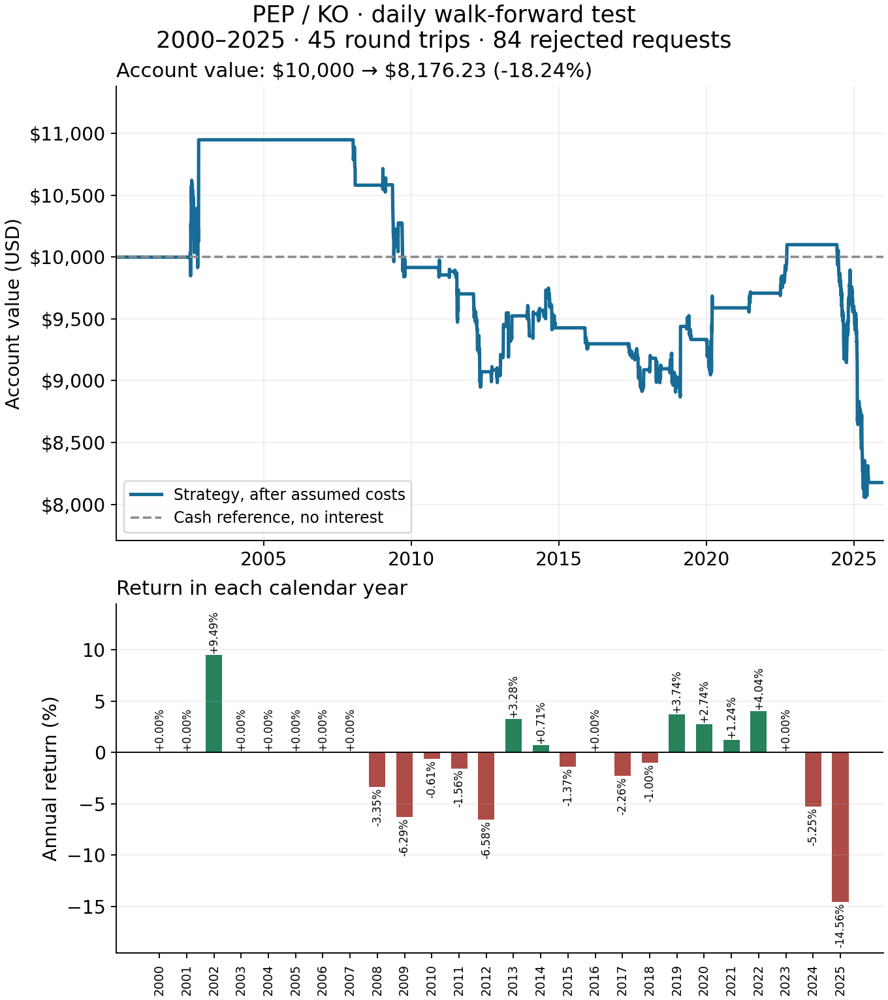
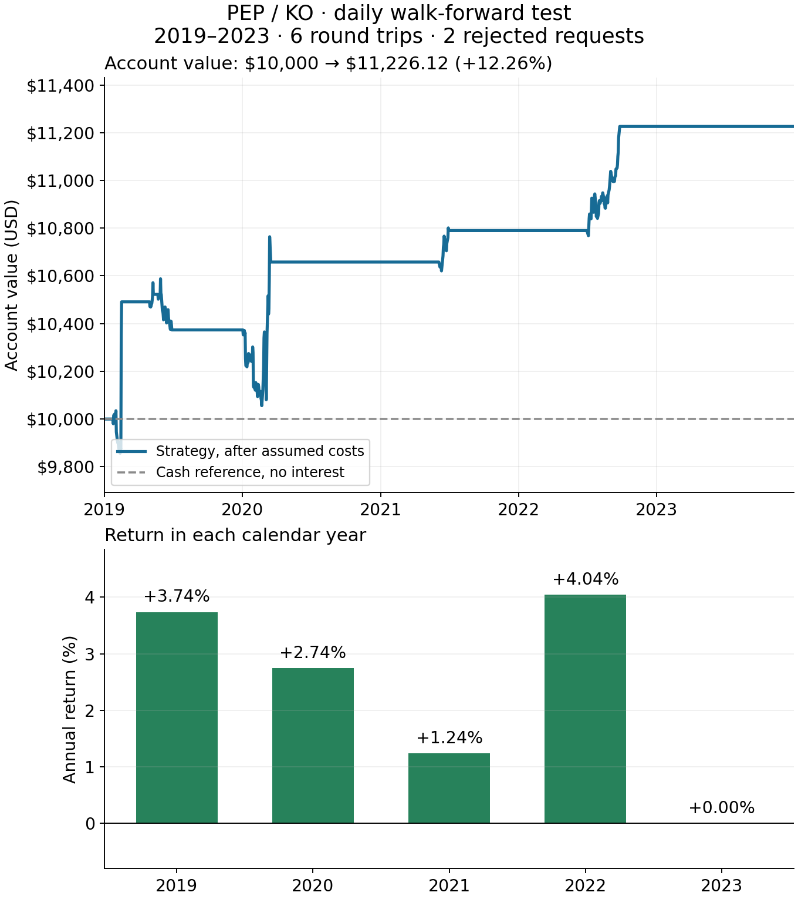
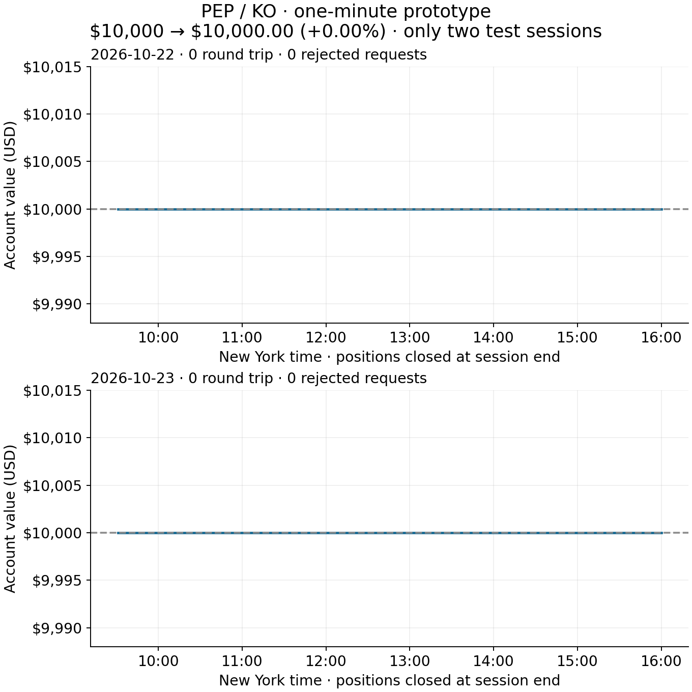

# Pair backtest graphs

These are hypothetical account values computed from real public price history, not actual brokerage returns. Both examples assume 0.10% fees and 0.10% slippage per fill, plus 1% annual short borrow under the stated observation-clock convention. Neither example is a certified profitability result.

## PepsiCo / Coca-Cola: 26-year daily test (2000–2025)

Using the same rules and assumed costs, $10,000 became **$8,176.23 (−18.24% cumulative)** over 6,539 daily observations, with **45 completed round trips**, 84 rejected requests and a **26.42% maximum drawdown**. The last two annual returns were −5.25% (2024) and −14.56% (2025). This longer history does not support the impression of profitability from the shorter 2019–2023 slice. Idle cash earns no interest. Fixed initial-capital sizing within each six-month cohort contributes to rejected entries; no thresholds or sizing rules were changed to improve this result.

Four years of preceding formation history are refitted every six months; capital carries forward and positions close at each six-month boundary. Includes assumed fees/slippage/borrow and net dividend accrual of −$343.44. Ex-date cash accrual remains an approximation to actual payment-date settlement. Yahoo Close and event dividends are both in split-adjusted units. The [issuer's 2012 dividend announcement](https://investors.coca-colacompany.com/news-events/press-releases/detail/384/the-board-of-directors-of-the-coca-cola-company-announces-quarterly-dividend) confirms $0.255 after the two-for-one split equals $0.51 before it; all four 2012 Yahoo quarterly events equal $0.255, so a second split adjustment would double-adjust dividends. The vendor's September 12, 2001 KO dividend falls during the market closure and is accrued at the first subsequent observed close (September 17), before fills. PEP's 1997 spin-off is in formation history only. Public vendor history is not a point-in-time audit, and the pair and period were chosen retrospectively.

[Full measured daily result](results/longer-pair-pep-ko-extended.json). Reproduce with `experiments/longer_pair_example.py --pair pep-ko --extended`, then `experiments/plot_pair_results.py --pair pep-ko --extended`. The earlier daily and minute examples below are preserved separately.

## PepsiCo / Coca-Cola: daily test

The same 2019–2023 walk-forward setup completed six round trips and rejected two requests. $10,000 became $11,226.12 (+12.26%) after assumed costs and net dividend accrual of −$88.46. Long dividend entitlements and short dividend liabilities accrue as cash on vendor ex-dates, rather than payment dates; taxes and funding differences are not modeled. Six trades do not establish repeatable profitability. [Measured daily result](results/longer-pair-pep-ko.json).

## PepsiCo / Coca-Cola: minute sample

The three-session formation fit selected the pure random-walk boundary with zero transient variance. The following October 22–23, 2026 sessions therefore had no trades and remained at $10,000. This is a fit outcome in a very short sample, not proof that mean reversion never exists. [Measured minute result](results/minute-pair-pep-ko.json).

## Alphabet: five-year daily test

The model refits on the preceding four years every six months. One capital account is rolled forward, with positions closed at each six-month boundary. The 2019–2023 test completed 19 round trips and rejected 56 requests. $10,000 ended at $9,234.47. The equity axis is deliberately enlarged to show changes; it does not begin at zero. The dashed cash reference assumes zero interest.

[Measured daily result](results/longer-pair-goog-googl.json).

## Alphabet: one-minute prototype

Three complete sessions provide formation data; the following two sessions are evaluated separately with positions flat every night. Account capital carries across the two sessions. It completed two round trips and rejected 54 requests under the existing initial-capital sizing/capacity rule. $10,000 ended at $9,921.84. Both panels use the same enlarged dollar scale and omit the overnight gap because no positions are held then.

Two sessions cannot establish stable intraday performance. Closing-bar prices are not synchronized executable bid/ask quotes, costs are assumed, and the filter treats successive observed bars as adjacent steps across overnight gaps. The large rejection count warrants a sizing review before expanding the study. Daily and minute results cover different periods and are not a controlled frequency comparison.

[Measured minute result](results/minute-pair-goog-googl.json).

Recreate the PNGs with `experiments/plot_pair_results.py` after the daily/minute example scripts have produced their local ledgers. This plotting command does not refit models, change thresholds or rerun trades.
