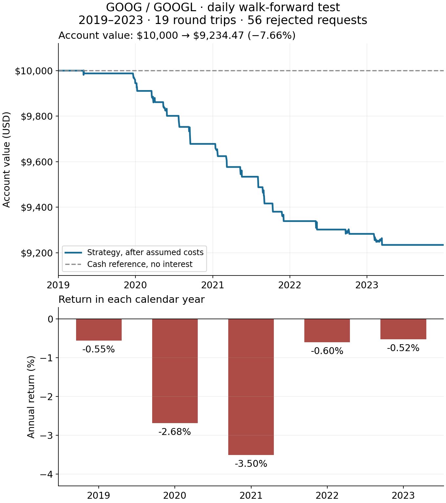
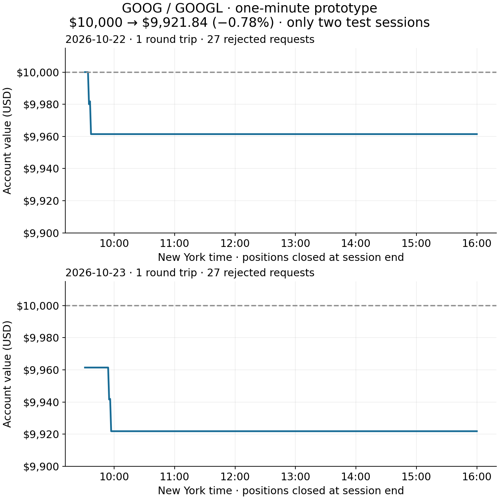

# GOOG / GOOGL backtest graphs

These are hypothetical account values computed from real public price history, not actual brokerage returns. Both examples assume 0.10% fees and 0.10% slippage per fill, plus 1% annual short borrow under the stated observation-clock convention. Neither example is a certified profitability result.

## Five-year daily test

The model refits on the preceding four years every six months. One capital account is rolled forward, with positions closed at each six-month boundary. The 2019–2023 test completed 19 round trips and rejected 56 requests. $10,000 ended at $9,234.47. The equity axis is deliberately enlarged to show changes; it does not begin at zero. The dashed cash reference assumes zero interest.

[Measured daily result](results/longer-pair-goog-googl.json).

## One-minute prototype

Three complete sessions provide formation data; the following two sessions are evaluated separately with positions flat every night. Account capital carries across the two sessions. It completed two round trips and rejected 54 requests under the existing initial-capital sizing/capacity rule. $10,000 ended at $9,921.84. Both panels use the same enlarged dollar scale and omit the overnight gap because no positions are held then.

Two sessions cannot establish stable intraday performance. Closing-bar prices are not synchronized executable bid/ask quotes, costs are assumed, and the filter treats successive observed bars as adjacent steps across overnight gaps. The large rejection count warrants a sizing review before expanding the study. Daily and minute results cover different periods and are not a controlled frequency comparison.

[Measured minute result](results/minute-pair-goog-googl.json).

Recreate the PNGs with `experiments/plot_pair_results.py` after the daily/minute example scripts have produced their local ledgers. This plotting command does not refit models, change thresholds or rerun trades.
