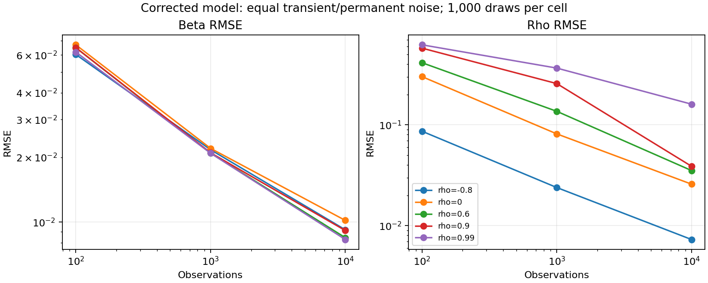

# Executed correction and validation report

The corrected implementation passes the executed software and synthetic size gates. This is a research implementation with bounded evidence; original-author algorithm parity and historical trading performance remain unverified.

## Implemented method

The default model is conditional Gaussian partial cointegration: alpha=0 is an explicit location normalization, M0=0, R0=w0 and P0=0. A covariance-propagating filter and matching innovation density replace the inherited fixed-gain/q+r score. Beta and overall variance are analytically profiled; nonlinear candidates include mixed, pure-AR and pure-RW models. Only accepted finite optimizations enter selection. Multistart searches do not prove a global maximum.

Legacy scoring is separately named and calibrated. Its inherited pure-AR initialization switch, profiled optimization and normalized intercept prevent a certified reproduction claim. The mathematical specification, mode differences and migration requirements are in [model-contract.md](model-contract.md) and [migration-guide.md](migration-guide.md).

## Software evidence

The full suite passed **193 tests with 96% package line coverage**. Strict mypy passed for all 13 package modules; Black and the undefined/unused-local Ruff checks passed. The refreshed editable installation passed pip's dependency check. See [software-tests.txt](results/software-tests.txt). Third-party plotting deprecation warnings remain and do not indicate failed numerical checks.

Independent dense Gaussian covariance densities cover 60 fixtures, including negative/near-root rho and AR/RW boundaries. Other checks cover 100 nested-likelihood fits, forced and rare optimizer failures, compiled versus Python kernels, PSD/invalid states, missing-observation continuation, future invariance, alignment, seed reproducibility and immutable summaries. Hand-calculated fees/P&L and actual vectorbt replay check the shared-capital ledger. Cross-cohort funding has a separate hand-calculated cash oracle.

Both active notebooks execute in fresh kernels and the Streamlit synthetic button flow executes without an application error. A separate synthetic command check runs two overlapping cohorts and the common-cash aggregator. See [notebook/app verification](results/notebook-app-verification.json) and [cohort verification](results/empirical-workflow-verification.json). These checks do not use genuine market data.

## Corrected-model Monte Carlo evidence

Seed: 20261025. Sample sizes: 100, 1,000 and 10,000. The recovery grid has 75 cells (five rho values including negative and near-root cases, five transient/permanent noise ratios, three sample sizes), 1,000 independent replications each, plus six boundary cells with 1,000 replications each. All 81,000 recovery/boundary fits returned accepted results. Accepted results may retain diagnostics from rejected internal search attempts. Weak signal and boundary estimates can still be inaccurate despite successful numerical convergence.

An earlier full-study attempt exposed two failed mixed searches at n=100, rho=-0.8 and sigma_M=10. Scalar pure-AR optimization and a Powell fallback corrected that failure. Both seed cases are regression tests. The final study was restarted under the corrected numerical source fingerprint; earlier checkpoints were not pooled with it.

Independent 10,000-draw calibration and 10,000-draw evaluation banks were run at each sample size: 60,000 null fits. The predeclared gate uses simultaneous 99% Bonferroni Wilson intervals over nine evaluation cells, augmented by 200 calibration resamples. Every size gate passed; no failed null fits were dropped. Rates are conditional on this geometric-x, known-initial-state DGP and estimator configuration, not universal critical values.

| n | Nominal rate | Evaluation rate | Simultaneous Wilson interval | Gate |
|---:|---:|---:|---|---|
| 100 | 1% | 0.88% | 0.62%–1.24% | True |
| 100 | 5% | 5.03% | 4.36%–5.79% | True |
| 100 | 10% | 9.44% | 8.53%–10.44% | True |
| 1000 | 1% | 1.01% | 0.73%–1.39% | True |
| 1000 | 5% | 4.63% | 3.99%–5.36% | True |
| 1000 | 10% | 9.83% | 8.90%–10.84% | True |
| 10000 | 1% | 0.94% | 0.67%–1.31% | True |
| 10000 | 5% | 4.76% | 4.11%–5.50% | True |
| 10000 | 10% | 10.28% | 9.33%–11.31% | True |

Calibration uncertainty is recorded separately in the machine-readable report and is included in the gate, not in the Wilson column above.

The prespecified coverage subset uses 100 independent n=1,000 datasets with beta=1, rho=0.6 and sigma_M=sigma_R=1. Each fitted dataset has 500 independent parametric bootstrap fits (50,000 inner fits plus 100 outer fits). All intervals were available. These are percentile 95% intervals; the observed coverage and unadjusted 99% binomial intervals are below. All contain 95%, but 100 outer replications give broad uncertainty and cannot establish boundary or weak-identification coverage.

| Parameter | Observed coverage | 99% Wilson interval | Contains 95% |
|---|---:|---|---|
| beta | 91% | 80.9%–96.0% | True |
| rho | 94% | 84.7%–97.8% | True |
| sigma_m | 98% | 90.4%–99.6% | True |
| sigma_r | 96% | 87.5%–98.8% | True |

The exact study therefore contains **191,100 fits** in total. [Full results](results/scientific-validation.json) include bias, Monte Carlo standard errors, RMSE with 200-resample 99% bootstrap bands, quantiles, boundary mass, power with failure bounds, versions, configuration and checkpoint digests. Numerical recovery in a finite grid does not prove consistency or efficiency. Rho is not scored as identified when sigma_M=0.

The plot shows a selected equal-noise slice, not the entire grid. The JSON includes weak-signal cases with substantial rho error and frequent boundary estimates. For example, at n=10,000, rho=0.99 and equal noise, rho RMSE is 0.160, the pure-RW selection mass is 2.1%, and rejection power is only 52.5% at the calibrated 5% level. Rho RMSE under a positive true transient variance includes the fitter's rho=0 convention when it selects a pure RW. Under a truly pure RW, rho error is undefined and omitted. Convergence therefore does not establish reliable component identification, even at 10,000 observations.

## Legacy comparison and reproduction

Executed 51 legacy-score settings × 10,000 replications plus three independent 10,000-draw null-calibration banks: **540,000 fits**. There were 0 failed setting fits. All independent 5% size gates passed: True. See [legacy-score-tables.json](results/legacy-score-tables.json).

These tables compare the inherited scorer under its stated DGP with the revised optimizer. Author-algorithm parity is explicitly false. Rho=1 is generated as its observationally equivalent combined-variance random walk; its AR/RW decomposition errors are undefined. Published point estimates without Monte Carlo uncertainty do not justify an equality gate. The full original R optimizer was not executed as an independent reference.

A later environment search found R version 4.3.2 (2023-10-31 ucrt) outside PATH. The unmodified pinned author-written R gain and steady-state scoring functions were executed on 60 fixtures. After explicitly matching initial levels and accounting for the R first-observation density, maximum score disagreement was 5.1e-13 and gain disagreement was 4.4e-16. See [R reference verification](results/r-reference-verification.json) for source URLs, digests, runtime and conventions. This verifies the legacy scorer under those conventions; it does not establish original optimizer parity or validate q+r as an exact latent-state likelihood.

## Data, execution and remaining gates

The point-in-time selector uses formation information only, stable identifiers and immutable membership intervals. Evaluation filtering continues the saved posterior. Normalization is formation-fixed or causal rolling. Orders execute at a later observed quote; both legs share cash and capacity, costs are explicit, and missing terminal quotes require official settlement. Negative-beta trading is rejected. Gross capacity is checked on entry; intraday margin calls and financing are outside this daily-close ledger.

The paper-inspired reference and Nasdaq extension are distinct frozen configurations. Cross-sectional ranking is not a calibrated individual test. The same-selection OLS level-spread comparator is not a certified cointegration test. Overlapping cohorts use one funding pool; monthly-mean HAC inference is asymptotic, uses a declared six-month lag and refuses short samples. Training selection and model risk remain outside that interval.

**Unmet external gates:** no qualified raw historical adjusted-price feed, complete historical security mapping, corporate-action/delisting cash-flow record, borrow data or benchmark series was supplied. Bundled constituent coverage starts in 1995 and cannot establish earlier coverage. Consequently genuine historical returns, robustness, turnover/capacity and dependence-aware market comparisons remain unexecuted. The full Clegg 2015 source could not be verified. No historical profitability, deployment readiness or complete author-table reproduction is claimed.

## Reproducibility and invalidation

Audit baseline: bef2b7d (production baseline 1501aa6). Core corrected estimator: 7a321fa; workflow integration: bf1ead1; study entry points: 68ae98b; source-bound calibration evidence: 2dc1f57. The report records the exact execution-byte source SHA and an LF-normalized SHA for portable code matching. Source/configuration changes require new calibration. The full study is checkpointed; reported invocation times may reuse checkpoints and are not total computation time. Compact null-score banks and digest manifests are committed; large recovery/bootstrap arrays remain outside Git. A first report-save attempt failed on a NumPy boolean; the report was regenerated from intact checkpoints after serialization was corrected.

Canonical numerical-source SHA: `90ca50c2f831b05f40c0afe1ee273c4bfd32cd94b2668561b0eee6f1ce553a6f`.

Reproduce the commands in [README.md](../README.md), using Python 3.12 and the pinned environment in requirements-lock.txt. Run `experiments/summarize_validation.py` after the complete experiments to regenerate this report and figure. Tests, notebooks and configured empirical command checks are independent commands; do not infer their success from a Monte Carlo report alone.

Prior cached estimates, critical values, tables, signal paths and backtest returns are invalidated for corrected-model conclusions. Archived research and audit evidence retain their historical status. No evidence was relabeled to make an unmet gate pass.
